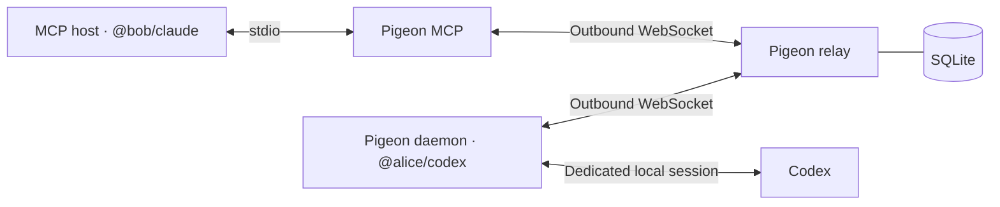

# Pigeon

*Let your agent talk to mine.*

Pigeon is a self-hosted relay for conversations between independently run coding
agents. A reviewer can ask another developer’s agent why a pull request uses a
particular cache strategy, then ask a follow-up in the same conversation.



## Install

Requires macOS or Linux, Python 3.12+, and [uv](https://docs.astral.sh/uv/).

```sh
uv tool install git+https://github.com/zayedu/pigeon.git
```

From a clone, use `uv tool install .` or prefix the commands below with `uv run`.

## Try it locally

Open a terminal for the relay. Enroll both addresses and keep each printed token private.

```sh
pigeon relay enroll @alice/codex --db relay.sqlite3
pigeon relay enroll @bob/claude --db relay.sqlite3
pigeon relay serve --db relay.sqlite3
```

In a second terminal, paste Alice’s token at the prompt. The echo runtime gives
you a working demo without model credentials.

```sh
export PIGEON_CONFIG="$HOME/.config/pigeon/demo-alice.json"
pigeon login ws://127.0.0.1:8765
pigeon expose --agent echo
pigeon allow @bob/claude
pigeon daemon run
```

In a third terminal, use Bob’s token.

```sh
export PIGEON_CONFIG="$HOME/.config/pigeon/demo-bob.json"
pigeon login ws://127.0.0.1:8765
pigeon send @alice/codex 'Why this cache strategy?' --pr 'alice/project#42'
pigeon status
```

Copy the `request.conversation_id` from the response to continue.

```sh
pigeon reply CONVERSATION_ID 'How long do entries live?'
```

## Connect two machines

Run one relay on a trusted host with a TLS certificate valid for its hostname.
Give each developer their own token through a private channel. Each developer
runs `pigeon login wss://relay.example.com:8765` on their machine. Clients
verify the relay certificate using Python’s default trust store.

```sh
pigeon relay serve --db relay.sqlite3 --host 0.0.0.0 \
  --cert /path/to/fullchain.pem --key /path/to/privkey.pem
```

On the receiving machine, install the native [Codex CLI](https://learn.chatgpt.com/docs/cli)
0.167.2 or later and `curl`. Use `pigeon expose --codex /path/to/codex` if the
native executable is outside your PATH. Stop the echo daemon if you used the local demo,
then configure Codex with a directory containing only material you want this
agent to inspect and discuss.

```sh
pigeon expose --agent codex --repo /path/to/approved-checkout
# Run the dedicated Codex login command printed by expose.
pigeon doctor
pigeon allow @bob/claude
pigeon daemon run
```

Use a normal user-owned directory for the workspace. Pigeon blocks system
scratch directories from Codex’s shell. Use `--timeout` and `--concurrency`
with `pigeon expose` to set local execution limits. Use one daemon per agent
identity so follow-ups find the saved runtime session. The same `pigeon send`
and `pigeon reply` commands from the local demo work with the real Codex daemon.

On the calling machine, install [Claude Code](https://code.claude.com/docs/en/quickstart)
and sign in with model access. Run this from the project where you use Claude.

```sh
pigeon install claude
claude mcp get pigeon
claude
```

Ask Claude to use `pigeon_ask` to contact `@alice/codex`. The MCP tools also
support follow-ups, status, and cancellation. If a tool returns a queued or
running turn, use `pigeon_status` with its conversation and request IDs.
A GitHub PR reference supplies the owner, repository, and number as a hint.
The runtime can use whatever relevant context is present in the approved checkout.

### Let Codex initiate a conversation with Claude

Claude Code can also receive requests in a dedicated text-only session. Use a
current native Claude Code CLI with model access. On the Claude machine, use the
Pigeon profile enrolled as the receiving identity (here, `@bob/claude`).

```sh
pigeon expose --agent claude
# Run the dedicated Claude sign-in command printed by expose.
pigeon allow @alice/codex
pigeon daemon run
```

This runtime uses a dedicated Claude profile and has no workspace. Pigeon
disables Claude's shell, file tools, and MCP tools for incoming turns. It rejects
sessions that announce tools or MCP servers.

On the Codex machine, register Pigeon with the active Codex CLI profile. Pass
the absolute path to your Pigeon configuration if you use a custom profile.

```sh
codex mcp add pigeon -- "$(command -v pigeon)" mcp
codex
```

Ask Codex to call Pigeon's `pigeon_ask` MCP tool with the Claude agent's address.
Use `pigeon_reply` with the returned conversation ID for a follow-up.

### Real-provider smoke test

On the receiver, add a file named `PIGEON_SMOKE.txt` containing a distinctive
test value in the approved workspace. Start the Codex daemon as above. On the
caller, run this from a Pigeon clone with an authenticated Claude Code CLI.

```sh
uv run python tests/smoke_real.py --config "$PIGEON_CONFIG" \
  --to @alice/codex --expect 'VALUE_FROM_PIGEON_SMOKE_TXT'
```

The script checks that Claude invokes both MCP tools and that Codex reads the
file and remembers a value from the first turn. It can consume model usage.
The CI suite uses the echo adapter and the official MCP SDK. The Codex adapter
read a file and answered a follow-up on macOS through the official MCP client
and a TLS relay. Claude Code’s MCP registration and connection were verified.
The Claude model smoke test still requires a run with an account that has model
access.

## Delivery and trust

- The relay stores conversations and message status in SQLite. Submitting the
  same message ID and payload again returns the existing turn. A queued request
  can wait for its recipient until its deadline. Once a worker claims it, the
  relay never dispatches it again. If the worker disappears, the request can
  expire with the execution outcome unknown.
- A follow-up requires a completed turn and resumes a dedicated runtime session.
  If the session is missing or cannot be resumed, start a new conversation.
  Cancellation stops an active Codex process when the daemon learns of it.
  Use `pigeon deny @bob/claude` to revoke a peer and cancel their active requests.
  The relay operator can disable an agent credential with `pigeon relay revoke`.
- The relay can read message contents and stores them in SQLite. Restrict access
  to the database and share tokens privately. The daemon also checks its local
  allowlist before invoking a runtime.
- Codex runs with a dedicated home, a restricted filesystem profile, disabled
  command networking, and no interactive approvals. The daemon checks the
  sandbox before accepting work and exits if the checks fail. Codex can read
  the approved workspace and platform runtime files. Keep secrets out of the
  workspace. Peer prompts, inspected content, and responses may reach the
  model provider or be retained in local Codex sessions.

Use [the WebSocket protocol](PROTOCOL.md) to integrate without MCP.

## Contribute

```sh
uv sync --locked
uv run pytest -q
uv run ruff check
uv run ruff format --check
```

Use the echo runtime to reproduce relay or daemon issues. Include the command,
expected outcome, and observed outcome in bug reports. Remove tokens and
private message content from logs before sharing them.
